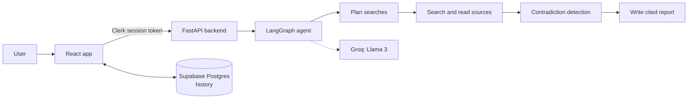

# DeepDive

**An autonomous research agent that searches the live web, cross-checks what it finds, and writes a report where every figure links to its source.**

DeepDive takes a question, plans a set of searches, reads the sources, flags where they disagree, and writes a structured, cited report. Reports are saved to a personal history, and you can ask follow-up questions that continue the same thread.

<!-- Add a screenshot: save it as docs/screenshot.png and uncomment the next line -->
<!--  -->

## Features

- **Multi-agent research pipeline.** A LangGraph agent plans searches, reads sources, and synthesises the findings into one report.
- **Contradiction detection.** A dedicated node compares sources and surfaces conflicting claims instead of hiding them.
- **Cited reports.** Figures link back to the pages they came from, so every claim can be checked.
- **Research depth.** Choose Quick, Standard or Deep to set how many sources are read and how long a run takes.
- **Follow-up threads.** Ask a follow-up and the agent continues the same conversation, or start a new thread.
- **History.** Reports are saved per user, searchable, and can be pinned or deleted.
- **Export.** Copy as Markdown, download as `.md`, or save as PDF.
- **Secure by default.** Sign-in with Clerk; each user only sees their own history.
- **Polished interface.** Animated depth selector, live colour background, skeleton loading states, light and dark themes, and a responsive layout.

## How it works



1. The React app sends the question to the FastAPI backend with the user's Clerk session token.
2. The LangGraph agent runs through planning, searching and reading, contradiction detection, and report writing.
3. The finished report is returned to the app and saved to Supabase.
4. Conversation state is checkpointed per thread, which is what makes follow-up questions possible.

## Tech stack

| Layer | Technology |
| --- | --- |
| Agent | LangGraph, Python |
| LLM | Groq, Llama 3 |
| API | FastAPI |
| Database | PostgreSQL on Supabase |
| Frontend | React, Vite |
| Auth | Clerk |
| Hosting | Vercel (frontend), Render (backend) |

## Project structure

```
deepdive-research-agent/
├── main.py                 # FastAPI app and routes
├── agent.py                # LangGraph agent and nodes
├── requirements.txt        # Python dependencies
├── supabase/               # Database schema and migrations
├── tests/                  # Backend tests
└── deepdive-frontend/      # React + Vite app
    └── src/
        ├── App.jsx         # Main workspace
        ├── api.js          # Calls the research endpoint
        ├── supabase.js     # Supabase client
        ├── history.js      # History helpers (list, save, pin, delete)
        ├── components/     # Sidebar, Composer, Report, RunPanel, ...
        ├── lib/            # Research depth settings
        └── styles/         # Design tokens and styles
```

## Getting started

### Prerequisites

- Python 3.10 or newer
- Node.js 18 or newer
- A [Groq](https://console.groq.com) API key
- A [Supabase](https://supabase.com) project
- A [Clerk](https://clerk.com) application

### 1. Clone

```bash
git clone https://github.com/SH-iva/deepdive-research-agent.git
cd deepdive-research-agent
```

### 2. Backend

```bash
python -m venv .venv
# Windows
.venv\Scripts\activate
# macOS / Linux
source .venv/bin/activate

pip install -r requirements.txt
```

Create a `.env` file in the repository root. The names below are typical; use the ones your `main.py` and `agent.py` actually read.

```env
GROQ_API_KEY=your_groq_key
SUPABASE_URL=your_supabase_url
SUPABASE_KEY=your_supabase_key
CLERK_SECRET_KEY=your_clerk_secret_key
```

Run the API:

```bash
uvicorn main:app --reload --port 8000
```

Interactive API docs are available at `http://localhost:8000/docs`.

### 3. Frontend

```bash
cd deepdive-frontend
npm install
```

Create `deepdive-frontend/.env`:

```env
VITE_CLERK_PUBLISHABLE_KEY=your_clerk_publishable_key
VITE_SUPABASE_URL=your_supabase_url
VITE_SUPABASE_ANON_KEY=your_supabase_anon_key
VITE_API_URL=http://localhost:8000
```

Start the dev server:

```bash
npm run dev
```

Open the address Vite prints, usually `http://localhost:5173`.

> Vite reads `.env` files when it starts, so restart the dev server after changing them.

### 4. Database

Apply the schema in the `supabase/` folder to your Supabase project (using the Supabase CLI or the SQL editor) so the reports table and its row-level security policies exist.

## Usage

1. Sign in.
2. Type a question, pick a depth (Quick, Standard or Deep), and press **Start research** or `Ctrl + Enter`.
3. Watch the progress steps while the report is written.
4. Read the report, follow citations to the sources, and export it if needed.
5. Ask a follow-up with **Continue this thread** ticked, or untick it to start a new topic.
6. Reopen, pin or delete past reports from the sidebar.

## Deployment

**Frontend on Vercel**

- Import the repository and set the root directory to `deepdive-frontend`.
- Framework preset: Vite. Build command: `npm run build`. Output directory: `dist`.
- Add the four `VITE_` environment variables from above, with `VITE_API_URL` pointing at the deployed backend.

**Backend on Render**

- Create a Web Service from the repository.
- Build command: `pip install -r requirements.txt`.
- Start command: `uvicorn main:app --host 0.0.0.0 --port $PORT`.
- Add the backend environment variables, and allow your Vercel domain in the CORS settings.
- Render's free tier spins down after 15 minutes of inactivity, so the first request afterwards is slow. Use a paid instance for an always-on backend.

## Roadmap

- Send the selected depth to the backend so it controls the number of sources read.
- Stream real progress from the agent instead of timed progress steps.
- Share reports through a public link.
- Compare two reports side by side.

## Author

Built by [Shiva Pandula](https://github.com/SH-iva).

## License

Add a license file (for example MIT) and name it here.
